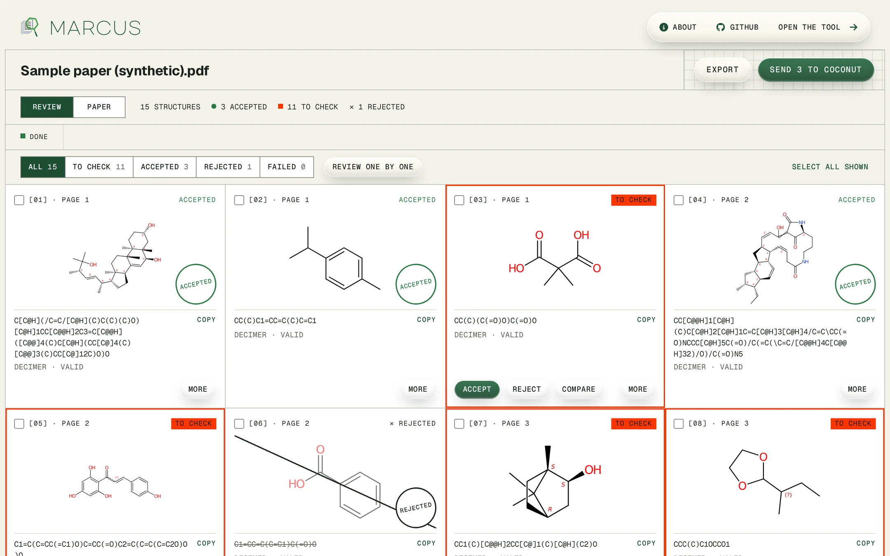
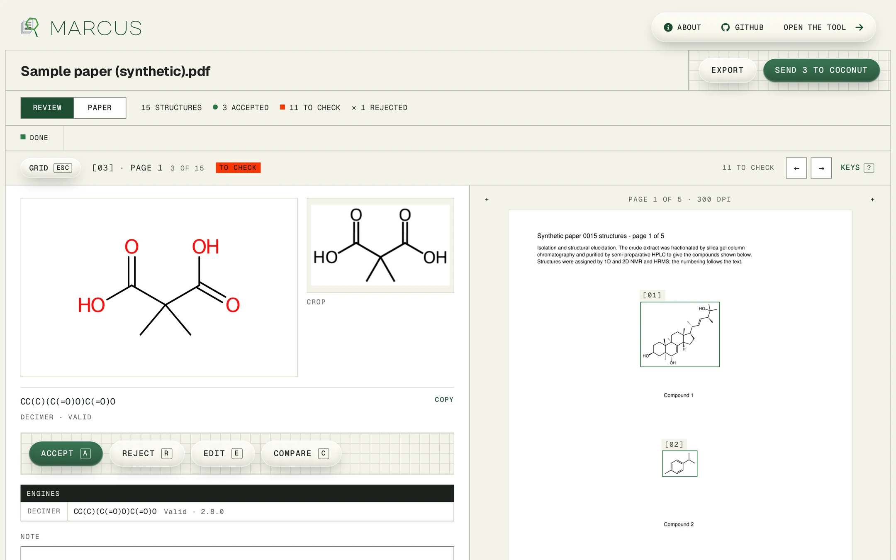
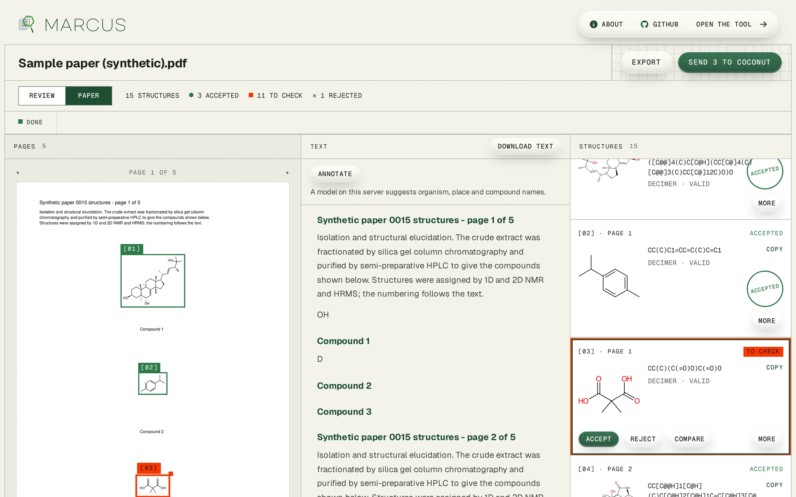

<p align="center">
  
</p>

<p align="center">
  <a href="https://doi.org/10.1039/d5dd00313j"></a>
  <a href="https://doi.org/10.5281/zenodo.24562147"></a>
  <a href="LICENSE"></a>
  
  <br>
  <a href="https://github.com/Kohulan/MARCUS/actions/workflows/backend-v2.yml"></a>
  <a href="https://github.com/Kohulan/MARCUS/actions/workflows/frontend-v2.yml"></a>
  <a href="https://github.com/Kohulan/MARCUS/actions/workflows/codeql.yml"></a>
</p>

<h3 align="center">
  <a href="https://marcus.decimer.ai">▶ Use MARCUS online: marcus.decimer.ai</a>
</h3>

<p align="center">
  No login, free, open source.
  <br>
  <a href="https://doi.org/10.1039/d5dd00313j">Read the paper</a>
  &nbsp;·&nbsp;
  <a href="#run-marcus-locally-with-docker">Run it locally</a>
  &nbsp;·&nbsp;
  <a href="#the-marcus-model">The MARCUS model</a>
  &nbsp;·&nbsp;
  <a href="#cite">Cite</a>
</p>

<picture>
  <source media="(prefers-color-scheme: dark)" srcset="docs/assets/readme/hero-dark.svg">
  
</picture>

<br>

MARCUS turns a journal article into checked chemical structures for
[COCONUT](https://coconut.naturalproducts.net). It finds every structure drawing in the PDF,
reads each one with several recognition engines, and puts a person in charge of the result:
accept, fix or reject, then submit. It is open source, free, needs no login, and runs on the
group's own GPU. No paper data goes to an outside AI service.

## How it works

<picture>
  <source media="(prefers-color-scheme: dark)" srcset="docs/assets/readme/pipeline-dark.svg">
  
</picture>

Results arrive one by one while the paper is still being read. A failed page or engine is
shown with its reason, never as "no structures".

## See it



<p align="center"><sub>THE REVIEW GRID · every structure with its SMILES, its engine and its state; bulk accept and reject</sub></p>

<table>
  <tr>
    <td width="50%" valign="top">
      
      <p align="center"><sub>FOCUS MODE · one structure, its crop and its page, a key for every action</sub></p>
    </td>
    <td width="50%" valign="top">
      
      <p align="center"><sub>PAPER VIEW · the pages, the extracted text and the structures side by side</sub></p>
    </td>
  </tr>
</table>

<sub>Screenshots of [marcus.decimer.ai](https://marcus.decimer.ai) on the built-in sample paper,
a synthetic article made for MARCUS (no copyrighted content).</sub>

## What is inside

| Step | What does it | What you get |
| :--- | :--- | :--- |
| Find the structures | [DECIMER Segmentation](https://github.com/Kohulan/DECIMER-Image-Segmentation) | a crop of every structure drawing, with its page and box |
| Read them | [DECIMER](https://github.com/Kohulan/DECIMER-Image_Transformer) (default), DECIMER hand-drawn, [MolParser](https://github.com/dptech-corp/MolParser), [MolScribe](https://github.com/thomas0809/MolScribe) | SMILES and molfiles; run all four and compare them side by side |
| Read the text | [Docling](https://github.com/docling-project/docling) | the paper's text and layout, and its DOI |
| Annotate | the MARCUS model, on [llama.cpp](https://github.com/ggml-org/llama.cpp) on the server's GPU | organism, part, place and compound names, each found in the text |
| Read R-group tables | the same MARCUS model, from the page image and its text | the compounds a scaffold with R-groups stands for (`3a: R1 = OMe`), to check against the paper |
| Check and fix | [Ketcher](https://github.com/epam/ketcher), [CDK](https://cdk.github.io/) depictions, PubChem and COCONUT lookups | a structure you have looked at, edited where it was wrong |
| Hand over | JSON, CSV and SDF export; COCONUT batch submission with your own COCONUT login | the accepted structures, where they belong |

## Your data

- **No account.** Each browser owns its papers through a secret cookie.
- **Kept 30 days.** Papers and their results are deleted after that.
- **Stays on our servers.** Recognition and annotation run on the group's own GPU; no paper
  text or image goes to an outside AI service.
- **Your COCONUT login stays yours.** It goes to COCONUT through the MARCUS relay; the
  server never stores it.

## Run MARCUS locally with Docker

There are two ways:

- **Try it (no GPU):** the whole app with fake engines. It starts in minutes and shows how
  MARCUS works, but the structures and annotations it returns are made up.
- **Full MARCUS (GPU):** the real engines and the MARCUS model, as on
  [marcus.decimer.ai](https://marcus.decimer.ai).

### 1. What you need

| | Try it | Full MARCUS |
| :--- | :--- | :--- |
| [Docker Engine](https://docs.docker.com/engine/install/) 24+ with Docker Compose v2 | yes | yes |
| Disk space | about 10 GB | about 60 GB (36 GB of images, 5 GB of model files, build space) |
| NVIDIA GPU | no | yes, about 20 GB of memory (the public server uses a V100 32 GB) |
| [NVIDIA Container Toolkit](https://docs.nvidia.com/datacenter/cloud-native/container-toolkit/latest/install-guide.html) | no | yes |

Check Docker with `docker compose version`. For the GPU, `docker run --rm --gpus all ubuntu nvidia-smi`
must list your GPU.

### 2. Get the code and make the settings file

```bash
git clone https://github.com/Kohulan/MARCUS.git
cd MARCUS/backend-v2
cp .env.example .env
```

Open `.env` and set the two passwords (any long random text, for example the output of
`openssl rand -hex 24`):

```
POSTGRES_PASSWORD=...
REDIS_PASSWORD=...
```

### 3a. Try it (no GPU)

```bash
docker compose -p marcus-v2 -f docker-compose.yml -f docker-compose.fake.yml up -d --build
```

### 3b. Full MARCUS (GPU)

Download the MARCUS model (5.2 GB, [Zenodo, DOI 10.5281/zenodo.24562147](https://doi.org/10.5281/zenodo.24562147)).
The script checks the files and prints two lines:

```bash
scripts/get-marcus-model.sh ./models
```

Put the two printed lines (`MARCUS_LLM_GGUF=...` and `MARCUS_LLM_MMPROJ=...`) in `.env`, then start:

```bash
docker compose -p marcus-v2 -f docker-compose.yml -f docker-compose.gpu.yml up -d --build
```

The first build takes a while (it downloads the engines' weights). The engines' model versions
are pinned in [`backend-v2/docker/MODEL_PINS.md`](backend-v2/docker/MODEL_PINS.md).

### 4. Open it

Open **http://localhost:18090/** and drop a PDF, or press *Try a sample paper*. To check that it runs:

```bash
curl http://localhost:18090/api/v2/health      # {"status":"ok"}
docker compose -p marcus-v2 ps                 # every service "Up", most "(healthy)"
```

### 5. Stop, update, remove

Use the same `-f` files as when you started (`docker-compose.fake.yml` or `docker-compose.gpu.yml`):

```bash
docker compose -p marcus-v2 -f docker-compose.yml -f docker-compose.gpu.yml stop       # stop
git pull && docker compose -p marcus-v2 -f docker-compose.yml -f docker-compose.gpu.yml up -d --build   # update
docker compose -p marcus-v2 -f docker-compose.yml -f docker-compose.gpu.yml down -v    # remove, with all papers
```

### If something goes wrong

- **A service keeps restarting:** `docker compose -p marcus-v2 logs --tail 50 <service>` shows why.
- **The page does not open:** MARCUS listens on 127.0.0.1 only; open it on the same machine, or put
  your own reverse proxy in front of port 18090.
- **No GPU in the containers:** install the NVIDIA Container Toolkit and restart Docker.
- **The model server does not start:** check the two model paths in `.env` (they must be full paths
  to the downloaded files).

[`backend-v2/README.md`](backend-v2/README.md) covers the details: the GPU stack, the MARCUS model,
the COCONUT relay, monitoring and API keys.

### The MARCUS model

The model that annotates papers and reads R-group tables, `nuextract3-marcus-multi-v1` (a LoRA
fine-tune of [NuExtract3](https://huggingface.co/numind/NuExtract3), Apache-2.0), is on Zenodo:
[doi.org/10.5281/zenodo.24562147](https://doi.org/10.5281/zenodo.24562147). Its model card lists
the training data, the scores and how to run it with llama.cpp on its own.

## Architecture

<picture>
  <source media="(prefers-color-scheme: dark)" srcset="docs/assets/readme/architecture-dark.svg">
  
</picture>

- **Web UI** ([`frontend-v2/`](frontend-v2)): React 18, TypeScript and Vite; the static pages are
  pre-rendered, and nginx serves it all on the same domain as the API.
- **API** ([`backend-v2/`](backend-v2)): FastAPI on Postgres, with the OpenAPI schema at
  `/api/v2/openapi.json`. Scripts can use it with an API key.
- **Workers:** one Celery queue on Redis per kind of work, so a slow engine never holds up the
  others.
- **The MARCUS model:** one model on one llama.cpp server on the GPU, with a slot each for
  annotation (q.llm) and R-group rows (q.rgroup).

## Development

```bash
# Backend: the tests need the test Postgres and Redis
cd backend-v2
docker compose -f docker-compose.test.yml up -d
uv sync --extra api --extra tools --extra dev
uv run pytest tests -m "not ml and not e2e"

# Web UI
cd frontend-v2
npm ci
npm run dev
```

The README graphics are drawn by [`docs/assets/readme/build.py`](docs/assets/readme/build.py).

## Cite

If MARCUS helps your work, please cite:

> Rajan K., Weißenborn V., Lederer L., Zielesny A., Steinbeck C.
> **MARCUS: molecular annotation and recognition for curating unravelled structures.**
> *Digital Discovery* 2025, 4(11), 3137–3148.
> [doi:10.1039/d5dd00313j](https://doi.org/10.1039/d5dd00313j)

<details>
<summary>BibTeX</summary>

```bibtex
@article{rajan2025marcus,
  title   = {{MARCUS}: molecular annotation and recognition for curating unravelled structures},
  author  = {Rajan, Kohulan and Wei{\ss}enborn, Viktor and Lederer, Laurin and Zielesny, Achim and Steinbeck, Christoph},
  journal = {Digital Discovery},
  year    = {2025},
  volume  = {4},
  number  = {11},
  pages   = {3137--3148},
  doi     = {10.1039/d5dd00313j}
}
```

</details>

## Thanks

MARCUS stands on open tools:
[CDK](https://cdk.github.io/) ·
[DECIMER](https://github.com/Kohulan/DECIMER-Image_Transformer) ·
[DECIMER Segmentation](https://github.com/Kohulan/DECIMER-Image-Segmentation) ·
[Docling](https://github.com/docling-project/docling) ·
[Ketcher](https://github.com/epam/ketcher) ·
[llama.cpp](https://github.com/ggml-org/llama.cpp) ·
[MolParser](https://github.com/dptech-corp/MolParser) ·
[MolScribe](https://github.com/thomas0809/MolScribe) ·
[RDKit](https://www.rdkit.org/)

Part of the [DECIMER](https://decimer.ai) project, connected to
[COCONUT](https://coconut.naturalproducts.net) and [NFDI4Chem](https://www.nfdi4chem.de).

## Licence and contact

<p>
  Built with  by
  <a href="https://kohulanr.com">Kohulan.R</a> at the
  <a href="https://github.com/Steinbeck-Lab">Steinbeck Lab</a>,
  <a href="https://www.uni-jena.de">Friedrich Schiller University Jena</a>
</p>

MIT, see [LICENSE](LICENSE). Questions:
[Kohulan Rajan](mailto:kohulan.rajan@uni-jena.de) ·
[decimer.ai](https://decimer.ai) ·
[Cheminformatics and Computational Metabolomics](https://cheminf.uni-jena.de/)

<br>

<p align="center">
  <a href="https://cheminf.uni-jena.de">
    
  </a>
</p>
